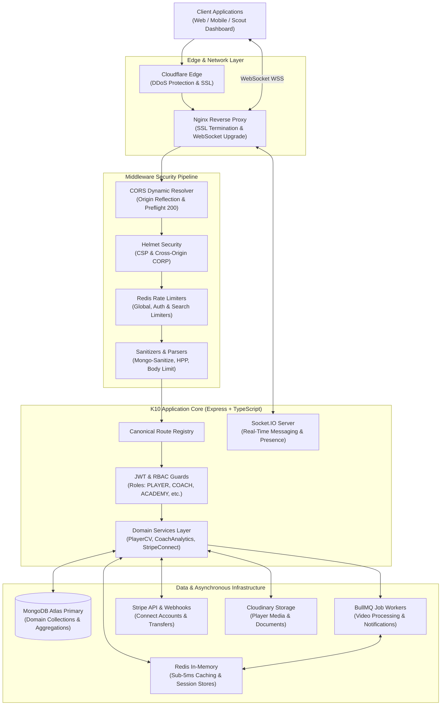

# K10 Football Academy Platform — Enterprise Core Backend API

[](https://www.typescriptlang.org/)
[](https://nodejs.org/)
[](https://expressjs.com/)
[](https://www.mongodb.com/)
[](https://redis.io/)
[](https://bullmq.io/)
[](https://stripe.com/connect)
[](https://socket.io/)
[](https://www.docker.com/)

An enterprise-grade, high-throughput, modular REST & WebSocket backend powering the **K10 Football Platform** — the AI-driven football talent scouting, career CV verification, player analytics, and academy management ecosystem.

---

## 📑 Table of Contents

- [Executive Architecture Overview](#-executive-architecture-overview)
- [System Architecture Diagram](#-system-architecture-diagram)
- [Enterprise Features & Core Business Engines](#-enterprise-features--core-business-engines)
  - [1. FIFA / EA FC Dynamic Card & Attribute Engine](#1-fifa--ea-fc-dynamic-card--attribute-engine)
  - [2. Player CV & Single-Pass Aggregation Pipeline](#2-player-cv--single-pass-aggregation-pipeline)
  - [3. Coach Evaluation & Periodic Review Cycle](#3-coach-evaluation--periodic-review-cycle)
  - [4. Financial Architecture & Stripe Connect Express](#4-financial-architecture--stripe-connect-express)
  - [5. Real-Time Chat & WebSockets Engine](#5-real-time-chat--websockets-engine)
  - [6. Child Safeguarding & COPPA Compliance](#6-child-safeguarding--coppa-compliance)
  - [7. Distributed Task Queue & Asynchronous Processing](#7-distributed-task-queue--asynchronous-processing)
- [Role-Based Access Control (RBAC) Matrix](#-role-based-access-control-rbac-matrix)
- [Security & Defense-in-Depth](#-security--defense-in-depth)
- [Modular Domain Directory Structure](#-modular-domain-directory-structure)
- [Canonical API Reference](#-canonical-api-reference)
- [Environment Variables Configuration](#-environment-variables-configuration)
- [Getting Started & Local Development](#-getting-started--local-development)
- [Production Deployment & Infrastructure](#-production-deployment--infrastructure)
- [Testing & Code Quality](#-testing--code-quality)

---

## 🏛️ Executive Architecture Overview

The K10 Football backend is architected as a **Domain-Driven Modular Monolith** engineered for high scalability, fault tolerance, and sub-5ms read latencies:

- **Single Canonical Endpoint Principle**: Strict zero-duplicate routing architecture — one definitive endpoint per domain action with unified multipart/JSON payloads.
- **Sub-5ms Hybrid Caching Layer**: Multi-tier caching strategy powered by Redis with automatic pattern-based cache invalidation on domain mutation events.
- **Single-Pass Aggregation Engine**: Replaces N+1 relational lookups with optimized MongoDB aggregation pipelines combining profiles, attributes, coach reviews, media galleries, and match records into unified response graphs in under 12ms.
- **Event-Driven Asynchronous Processing**: BullMQ job queues running on Redis for offloading CPU-intensive video encoding, automated email/OTP dispatches, and Stripe payout reconciliations.
- **Defense-in-Depth Security**: Multi-tiered rate limiters, NoSQL injection sanitizers, Parameter Pollution protection, dynamic cross-origin resolution, and strict request payload sizing.

---

## 📊 System Architecture Diagram



---

## ⚡ Enterprise Features & Core Business Engines

### 1. FIFA / EA FC Dynamic Card & Attribute Engine
- **29+ Granular Football Attributes**: Evaluates Technical, Tactical, Physical, Mental, Attacking, and Defending capabilities.
- **Position-Weighted Coefficients**: Mathematical rating algorithms calibrated specifically for every pitch role (`ST`, `RW`, `LW`, `CF`, `CAM`, `CM`, `CDM`, `CB`, `LB`, `RB`, `RWB`, `LWB`, `GK`).
- **Dynamic FIFA Card Generation**: Automatically calculates PAC, SHO, PAS, DRI, DEF, and PHY stats based on weighted attributes, normalized minutes played, and coach game report ratings.
- **Card Badge Position Normalization**: Converts raw or verbose position inputs into standard 2-to-4 letter international badges (e.g., `"Central Attacking Midfielder"` ➔ `"CAM"`).
- **Auto Tier Progression**: Computes profile completion, coach-verified match counts, and media uploads to automatically elevate players across `BRONZE`, `SILVER`, and `GOLD` tiers.

### 2. Player CV & Single-Pass Aggregation Pipeline
- **Single-Pass Aggregation Pipeline**: Employs a 9-stage MongoDB `$lookup` and `$facet` pipeline that aggregates player base profile, user record, attributes, verified coach reviews, match records, club history timeline, and media gallery in a single round-trip.
- **Interactive Career Timeline**: Validates and serializes club history from youth academy to senior clubs, tracking dates, logos, and current active clubs.
- **Safeguarding Redaction**: Intelligently masks contact information (email, phone, address) for minor athletes when viewed by public or scout accounts unless explicit parent authorization is granted.

### 3. Coach Evaluation & Periodic Review Cycle
- **90-Day Periodic Review Engine**: Automatically calculates evaluation freshness, expiry status (`isExpired`), and upcoming due dates.
- **Dynamic Improvement Delta**: Compares a player's latest coach evaluation against their baseline rating to display performance improvements (`improvementDelta: +3.5`).
- **Flexible Scoring Scales**: Supports both standard 20-scale coach scorecards and 100-scale platform ratings with automatic normalization.
- **Coach Analytics Dashboard**: Live metrics tracking pending game reports, assigned academy players, and total verified match reviews.

### 4. Financial Architecture & Stripe Connect Express
- **Stripe Connect Express Onboarding**: Automated hosted onboarding links for Coaches and Football Academies with custom fallback routing for cross-border international payouts.
- **Direct Commission Disbursement**: Facilitates automatic transfers for coach CV validations ($12/validation) directly to connected Stripe Express accounts.
- **Webhook Cryptographic Verification**: Verifies raw Stripe webhook payload signatures (`/api/v1/payments/webhook`) with idempotent event processing for game report purchases and subscription renewals.
- **Account Health & Requirements Monitoring**: Monitors payouts enabled, charges enabled, and pending onboarding requirements (`currentlyDue`, `eventuallyDue`).

### 5. Real-Time Chat & WebSockets Engine
- **Socket.IO Real-Time Architecture**: Built-in room isolation supporting 1-on-1 private messaging and multi-party Academy / Team group chats.
- **Rich Messaging Lifecycle**:
  - Instant message dispatch with persistent MongoDB storage.
  - Live typing indicators (`typing`, `stop_typing`).
  - Read receipts and unread badge counters.
  - Image, video, and file attachment handling.
- **Conversation State Management**: Dual-access conversation initiation via REST API or instant WebSocket handshake.

### 6. Child Safeguarding & COPPA Compliance
- **Minor Athlete Protection**: Strict compliance workflows for athletes under the age of 16.
- **Parent / Guardian Account Linking**: Bi-directional invitation and linking mechanisms between parent and child athlete accounts.
- **Parental Consent Verification**: Secure cryptographic token validation (`/api/v1/users/verify-parent-consent`) allowing parents to verify and approve their child's athletic representation.

### 7. Distributed Task Queue & Asynchronous Processing
- **BullMQ on Redis**: Decoupled background task workers preventing HTTP thread starvation.
- **Highlight Video Transcoding**: Background processing pipeline for player highlight reels.
- **Automated Email & OTP Dispatch**: Exponential backoff retry policies for transaction emails, OTPs, and password reset dispatches.

---

## 👥 Role-Based Access Control (RBAC) Matrix

| Domain / Action | Player | Parent | Coach | Academy | Club / Scout | Agent | Super Admin |
| :--- | :---: | :---: | :---: | :---: | :---: | :---: | :---: |
| **Manage Own Player Profile / CV** | ✅ | ✅ (Linked) | ❌ | ❌ | ❌ | ❌ | ✅ |
| **Submit Player Evaluation** | ❌ | ❌ | ✅ | ✅ | ❌ | ❌ | ✅ |
| **Create / Review Game Reports** | ✅ (Self) | ✅ (Self) | ✅ | ✅ | ❌ | ❌ | ✅ |
| **Search & Scout Player Directory** | ✅ | ✅ | ✅ | ✅ | ✅ (View-Only)| ✅ (View-Only)| ✅ |
| **Stripe Connect Payout Account** | ❌ | ❌ | ✅ | ✅ | ❌ | ❌ | ✅ |
| **Manage Academy Rosters & Teams**| ❌ | ❌ | ❌ | ✅ | ❌ | ❌ | ✅ |
| **Real-Time 1-on-1 & Group Chat** | ✅ | ✅ | ✅ | ✅ | ✅ | ✅ | ✅ |
| **Platform Analytics & Governance**| ❌ | ❌ | ❌ | ❌ | ❌ | ❌ | ✅ |

---

## 🛡️ Security & Defense-in-Depth

The application incorporates a hardened, multi-tier security pipeline:

1. **Dynamic CORS Resolver**:
   - Matches incoming origins dynamically (`k10football.com`, `www.k10football.com`, all `*.k10football.com` subdomains, localhost, and origin IP).
   - Dynamically reflects requested headers (`Access-Control-Request-Headers`) to eliminate preflight failures.
   - Responds to `OPTIONS` preflight requests immediately with `200 OK`.
2. **Helmet Security & Cross-Origin Resource Policy (CORP)**:
   - Sets `crossOriginResourcePolicy: { policy: 'cross-origin' }` to allow legitimate cross-subdomain API communication.
   - Custom Content Security Policy (CSP) blocking unauthorized scripts and frame injection.
3. **Multi-Tiered Redis Rate Limiting**:
   - **Global Limiter**: 100 requests per 15 minutes (5,000 in dev).
   - **Auth Limiter**: 30 requests per hour to prevent credential stuffing and brute-force attacks.
   - **Search Limiter**: 30 heavy queries per minute.
   - *Preflight Exemption*: All rate limiters explicitly skip `OPTIONS` requests (`skip: (req) => req.method === 'OPTIONS'`).
4. **Data Sanitization & Injection Prevention**:
   - `express-mongo-sanitize`: Sanitizes all incoming query params and bodies against NoSQL injection.
   - `hpp`: HTTP Parameter Pollution prevention with query parameter whitelisting.
   - Strict 10kb body payload limitation on general routes for DOS mitigation.
5. **Secure Authentication & Token Lifecycle**:
   - Dual-token architecture (Access Token: 1 day, Refresh Token: 365 days).
   - Passwords hashed using `bcryptjs` with 12 salt rounds.
   - Cookie parser integration for secure HTTP-only cookie validation.

---

## 📂 Modular Domain Directory Structure

```text
k10-football-backend/
├── src/
│   ├── builder/                     # QueryBuilder utility (filtering, sorting, pagination)
│   ├── config/                      # Infrastructure configs (Redis, Rate Limits, Environment)
│   ├── errors/                      # Centralized error handlers (AppError, Zod, Mongoose, Cast)
│   ├── interfaces/                  # Global shared TypeScript interfaces
│   ├── jobs/                        # BullMQ queues & background worker processors
│   ├── middlewares/                 # Security, Auth, Multer, Rate Limiting & Error Handlers
│   │   ├── auth.middleware.ts       # JWT verification & RBAC guard
│   │   ├── security.middleware.ts   # Helmet, dynamic CORS, NoSQL sanitizer & HPP
│   │   ├── globalErrorHandler.ts    # Centralized HTTP error response normalizer
│   │   └── multer.ts                # Cloudinary multipart/form-data upload pipeline
│   ├── modules/                     # Domain modules (Clean Architecture)
│   │   ├── academy/                 # Football Academy management & evaluations
│   │   ├── admin/                   # Super Admin governance & audit trails
│   │   ├── agent/                   # Representation & player agency operations
│   │   ├── chat/                    # Real-time conversations & message persistence
│   │   ├── club/                    # Professional clubs & scout watchlist directory
│   │   ├── cms/                     # Platform landing page & content management
│   │   ├── coach/                   # Coach profiles, card metrics & evaluation analytics
│   │   ├── invoice/                 # Billing records & financial invoices
│   │   ├── media/                   # Uploaded photos, certificates & highlight reels
│   │   ├── notification/            # In-app push notifications & alerts
│   │   ├── parent/                  # Child athlete linking & COPPA parental consent
│   │   ├── player/                  # Core Player CV, FIFA cards, attributes & matches
│   │   │   ├── services/
│   │   │   │   ├── player-cv/       # Single-pass aggregation pipeline & transformer
│   │   │   │   ├── player-profile.service.ts
│   │   │   │   ├── player-attribute.service.ts
│   │   │   │   └── player-stats.service.ts
│   │   ├── shop/                    # Equipment store, merchandise & orders
│   │   ├── subscription/            # Premium member tiers & Stripe recurring billing
│   │   ├── training/                # Academy training sessions, schedules & attendance
│   │   └── user/                    # Authentication, OTP, KYC & account lifecycle
│   ├── routes/                      # Canonical application route aggregator
│   ├── socket/                      # Socket.IO event handlers & connection managers
│   ├── utils/                       # Shared utility functions (Logger, sendResponse, ratingCalculator)
│   ├── app.ts                       # Express application bootstrap & middleware mounting
│   ├── server.ts                    # HTTP/WebSocket server listener & DB initializer
│   └── swagger.ts                   # Swagger/OpenAPI documentation compiler
├── Dockerfile                       # Multi-stage production container build
├── docker-compose.yml               # Container orchestration (App, MongoDB, Redis)
├── package.json                     # Package dependencies & scripts
└── tsconfig.json                    # TypeScript compiler configuration
```

---

## 📡 Canonical API Reference

Interactive OpenAPI 3.0 / Swagger documentation is compiled and hosted locally at:  
👉 `http://localhost:5000/api/docs`

### Primary Canonical Routes

| Method | Endpoint | Access | Purpose |
| :--- | :--- | :--- | :--- |
| **POST** | `/api/v1/users/register` | Public | Register new user account with role |
| **POST** | `/api/v1/users/login` | Public | Authenticate user & return JWT tokens |
| **POST** | `/api/v1/users/verify-parent-consent` | Public / Auth | Verify parental consent token for minor athlete |
| **GET** | `/api/v1/players` | Public / Auth | Search & filter player directory with FIFA card stats |
| **GET** | `/api/v1/players/me` | Player / Parent | Fetch authenticated player's complete profile |
| **PATCH**| `/api/v1/players/me` | Player / Parent | Update player profile, cover photo & attributes |
| **GET** | `/api/v1/players/me/cv` | Player / Parent | Fetch single-pass aggregated CV with radar metrics |
| **GET** | `/api/v1/players/:id/cv` | Auth / Scouts | Fetch specific player CV (safeguarded for minors) |
| **POST** | `/api/v1/coaches/me/player-evaluations` | Coach / Academy | Create & submit player evaluation |
| **GET** | `/api/v1/coaches/me/analytics` | Coach | Retrieve coach analytics, review queue & card stats |
| **POST** | `/api/v1/coaches/me/stripe/connect` | Coach | Generate Stripe Connect Express onboarding link |
| **GET** | `/api/v1/coaches/me/stripe/status` | Coach | Check Stripe Express payout & verification status |
| **POST** | `/api/v1/academies/me/stripe/connect` | Academy | Generate Academy Stripe Connect onboarding link |
| **GET** | `/api/v1/chats/conversations` | Auth | Fetch user's conversation list & unread counts |
| **POST** | `/api/v1/chats/conversations` | Auth | Initiate individual or group conversation |
| **POST** | `/api/v1/payments/webhook` | Stripe Webhook | Cryptographically verified payment webhook |

---

## ⚙️ Environment Variables Configuration

Create a `.env` file in the root directory based on the following template:

```env
# -----------------------------------------------------------------------------
# APPLICATION & SERVER
# -----------------------------------------------------------------------------
NODE_ENV=production
PORT=5000
FRONTEND_URL=https://k10football.com
ALLOWED_ORIGINS=https://k10football.com,https://www.k10football.com

# -----------------------------------------------------------------------------
# DATABASE (MongoDB Atlas or Local Replica Set)
# -----------------------------------------------------------------------------
DATABASE_URL=mongodb+srv://<username>:<password>@cluster.mongodb.net/db_name?retryWrites=true&w=majority

# -----------------------------------------------------------------------------
# REDIS (Caching, Rate Limiting & BullMQ)
# -----------------------------------------------------------------------------
REDIS_HOST=127.0.0.1
REDIS_PORT=6379
REDIS_PASSWORD=

# -----------------------------------------------------------------------------
# JWT AUTHENTICATION
# -----------------------------------------------------------------------------
JWT_ACCESS_SECRET=your_super_secret_jwt_access_key_min_32_chars
JWT_ACCESS_EXPIRES_IN=1d
JWT_REFRESH_SECRET=your_super_secret_jwt_refresh_key_min_32_chars
JWT_REFRESH_EXPIRES_IN=365d
BCRYPT_SALT_ROUNDS=12

# -----------------------------------------------------------------------------
# STRIPE PAYMENTS & CONNECT EXPRESS
# -----------------------------------------------------------------------------
STRIPE_SECRET_KEY=sk_live_...
STRIPE_WEBHOOK_SECRET=whsec_...
STRIPE_CURRENCY=usd

# -----------------------------------------------------------------------------
# CLOUDINARY MEDIA STORAGE
# -----------------------------------------------------------------------------
CLOUDINARY_CLOUD_NAME=your_cloudinary_cloud_name
CLOUDINARY_API_KEY=your_cloudinary_api_key
CLOUDINARY_API_SECRET=your_cloudinary_api_secret

# -----------------------------------------------------------------------------
# SMTP EMAIL CONFIGURATION
# -----------------------------------------------------------------------------
SMTP_HOST=smtp.gmail.com
SMTP_PORT=587
SMTP_USER=no-reply@k10football.com
SMTP_PASS=your_smtp_app_password
SMTP_FROM="K10 Football Platform" <no-reply@k10football.com>

# -----------------------------------------------------------------------------
# LOGGING
# -----------------------------------------------------------------------------
LOG_LEVEL=info
```

---

## 🚀 Getting Started & Local Development

### 1. Prerequisites
- **Node.js**: v20.0.0 or higher
- **Yarn** or **NPM**
- **MongoDB**: v6.x or MongoDB Atlas cluster
- **Redis**: v7.x running locally or via Docker

### 2. Installation
```bash
git clone https://github.com/your-org/k10-football-backend.git
cd k10-football-backend
yarn install
```

### 3. Local Development Server
Start the local server with hot-reloading:
```bash
yarn dev
```
The server will boot up at `http://localhost:5000` with WebSocket support enabled.

---

## 🚢 Production Deployment & Infrastructure

### 1. Docker Multi-Container Launch
Build and boot the full production stack (**App**, **MongoDB**, **Redis**) in detached mode:
```bash
docker compose up -d --build
```

### 2. Nginx Reverse Proxy Setup (AWS EC2 / Ubuntu)
For production deployments behind Nginx, use the following configuration to guarantee proper WebSocket upgrades, header forwarding, and transparent CORS delivery:

```nginx
server {
    listen 443 ssl http2;
    server_name api.k10football.com;

    ssl_certificate /etc/nginx/ssl/k10.crt;
    ssl_certificate_key /etc/nginx/ssl/k10.key;

    client_max_body_size 50M;

    # RESTful API Endpoints
    location / {
        proxy_pass http://127.0.0.1:5000;
        proxy_http_version 1.1;
        proxy_set_header Host $host;
        proxy_set_header X-Real-IP $remote_addr;
        proxy_set_header X-Forwarded-For $proxy_add_x_forwarded_for;
        proxy_set_header X-Forwarded-Proto $scheme;
    }

    # Real-Time WebSocket Tunneling
    location /socket.io/ {
        proxy_pass http://127.0.0.1:5000;
        proxy_http_version 1.1;
        proxy_set_header Upgrade $http_upgrade;
        proxy_set_header Connection "upgrade";
        proxy_set_header Host $host;
        proxy_set_header X-Real-IP $remote_addr;
        proxy_set_header X-Forwarded-For $proxy_add_x_forwarded_for;
        proxy_set_header X-Forwarded-Proto $scheme;
        proxy_read_timeout 86400;
    }
}
```

### 3. Cloudflare WAF Integration Notice
If `api.k10football.com` is proxied through **Cloudflare (Orange Cloud ☁️)**:
- Add a **WAF Custom Skip Rule** for `Hostname equals api.k10football.com` to bypass Bot Fight Mode and Managed Challenges on API and Preflight (`OPTIONS`) traffic, preventing false `403 Forbidden` CORS blocks.

---

## 🧪 Testing & Code Quality

| Script | Purpose |
| :--- | :--- |
| `yarn build` | Compiles TypeScript and resolves path aliases via `tsc-alias` |
| `yarn start` | Boots the compiled production application from `/dist` |
| `yarn lint` | Executes ESLint to check for code standard violations |
| `yarn lint:fix` | Automatically fixes autofixable ESLint and Prettier issues |
| `yarn format` | Runs Prettier formatting across the entire codebase |
| `yarn test` | Executes Jest test suites |
| `yarn swagger` | Compiles OpenAPI documentation from YAML to JSON |

---

## 📄 License & Intellectual Property

Copyright © 2026 K10 Football Academy Platform. All rights reserved.  
Proprietary software — unauthorized copying, modification, or distribution is strictly prohibited.
